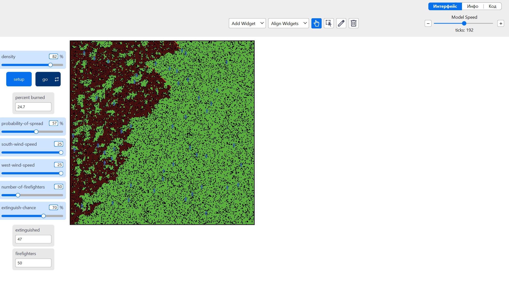
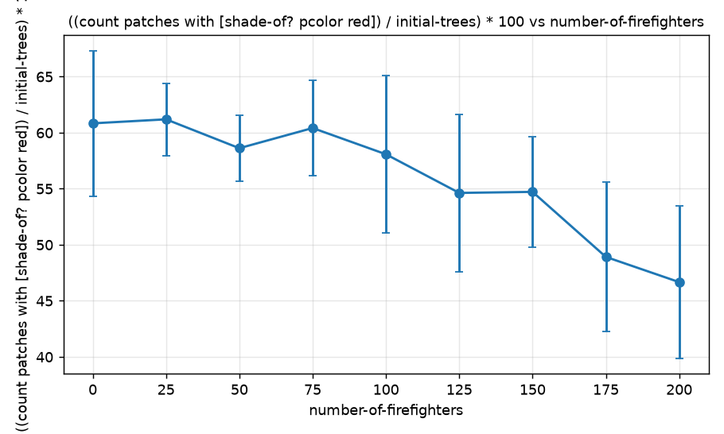

# Комп'ютерні системи імітаційного моделювання

## СПм-25-2, **Лебідь Іван Сергійович**

### Лабораторна робота №**2**. Редагування імітаційних моделей у середовищі NetLogo

<br>

### Варіант 5, модель у середовищі NetLogo:
[Fire Simple Extension 2](http://www.netlogoweb.org/launch#http://www.netlogoweb.org/assets/modelslib/IABM%20Textbook/chapter%203/Fire%20Extensions/Fire%20Simple%20Extension%202.nlogo)

<br>

### Внесені зміни у вихідну логіку моделі, за варіантом:

За варіантом необхідно було додати в модель агентів-«пожежників», кількість яких вказує користувач. Вони спочатку розміщуються лише на «порожніх» ділянках (де немає дерев), рухаються у випадковому напрямку, але лише по ділянках, які ще не згоріли (зелених або чорних), а при зустрічі з осередками вогню (червоними ділянками) «гасять» їх.

#### 1. Нова порода агентів та глобальна змінна
До моделі додано породу `firefighters` та глобальний лічильник загашених ділянок `extinguished-count`:

```NetLogo
breed [firefighters firefighter]

globals [
  initial-trees        ;; how many trees (green patches) we started with
  extinguished-count   ;; how many burning patches were put out by firefighters
]
```

#### 2. Створення та початкове розміщення пожежників
Кількість пожежників задається слайдером **`number-of-firefighters`** (0-200, за замовчуванням 50). У `setup` викликається нова процедура `setup-firefighters`, яка створює пожежників і розміщує кожного на випадковій **чорній** (порожній, без дерева) ділянці. Якщо порожніх ділянок немає взагалі (щільність 100 %), пожежник не створюється:

```NetLogo
to setup
  clear-all
  ...
  set initial-trees count patches with [pcolor = green]
  set extinguished-count 0
  setup-firefighters
  reset-ticks
end

to setup-firefighters
  set-default-shape firefighters "person"
  create-firefighters number-of-firefighters [
    set color blue
    set size 6
    ;; firefighters are placed randomly, but only on empty patches (without trees)
    let spot one-of patches with [ pcolor = black ]
    ifelse spot != nobody
    [ move-to spot ]
    [ die ]
  ]
end
```

#### 3. Випадковий рух пожежників лише по незгорілих ділянках
Пожежник щотакту переходить на одну з сусідніх (8 напрямків) ділянок, яка ще не горіла і не горить: зелену (дерево) або чорну (порожню). Якщо такої ділянки немає (оточений вогнем і згорілими ділянками), стоїть на місці:

```NetLogo
to move-firefighter  ;; firefighter procedure
  ;; random walk, but only over patches that have not burned yet (green or black)
  let options neighbors with [ pcolor = green or pcolor = black ]
  if any? options [ move-to one-of options ]
end
```

#### 4. Гасіння вогню
Після руху пожежник «гасить» усі палаючі (червоні) ділянки поруч із собою (8 сусідніх) та під собою. Загашена ділянка змінює колір на сірий, тож більше не горить, не поширює вогонь і не вважається такою, що згоріла; кожне гасіння додається до лічильника `extinguished-count`:

```NetLogo
to extinguish-fire  ;; firefighter procedure
  ;; try to put out every burning patch next to the firefighter (or under him)
  let fires (patch-set patch-here neighbors) with [ pcolor = red ]
  ask fires [
    if random 100 < extinguish-chance [
      set pcolor gray   ;; extinguished patch is not burning any more
      set extinguished-count extinguished-count + 1
    ]
  ]
end
```

#### 5. Порядок дій у головній процедурі
У `go` спочатку виконується вихідна логіка поширення вогню (без змін), а потім пожежники рухаються та гасять вогонь. Оскільки дерево горить рівно один такт, пожежники бачать вогонь саме в той момент, коли він щойно виник, і можуть загасити його до того, як він поширить далі на наступному такті:

```NetLogo
to go
  ;; stop the model when done
  if all? patches [ pcolor != red ] [ stop ]
  ask patches with [ pcolor = red ] [
    ...  ;; original fire spreading logic
  ]
  ;; firefighters walk around and put out the fire
  ask firefighters [
    move-firefighter
    extinguish-fire
  ]
  tick ;; advance the clock by one tick
end
```

<br>

### Внесені зміни у вихідну логіку моделі, на власний розсуд:

**Імовірність успішного гасіння.** Спроба загасити вогонь вдається не завжди, а лише з імовірністю, що задається слайдером **`extinguish-chance`** (0-100 %, за замовчуванням 70). Таким чином, кожен пожежник «ефективний» лише частково, що реалістичніше, ніж безвідмовне гасіння.

**Інтерфейс.** Додано слайдери `number-of-firefighters` та `extinguish-chance` та два монітори: кількість загашених ділянок (`extinguished`) і кількість пожежників (`firefighters`). Монітор `percent burned` вихідної моделі залишився, і тепер за його допомогою можна оцінити ефективність пожежників (загашені ділянки сірі, тому в нього не потрапляють).



Фінальний код моделі та її інтерфейс доступні за [посиланням](Fire%20Simple%20Extension%202_modified.nlogox).

<br>

## Обчислювальний експеримент

> **Як проводився експеримент:** BehaviorSpace, експеримент `L2-E1 number-of-firefighters` у файлі `Fire Simple Extension 2_modified.nlogox`. Кожне значення - 10 прогонів до повного згасання пожежі (макс. 2000 тактів); фіксувались `percent burned` у кінці, кількість загашених ділянок та тривалість у тактах. У таблиці - середнє по 10 прогонах.

### 1. Вплив кількості пожежників на відсоток згорілого лісу
Досліджується залежність відсотка згорілого лісу та кількості загашених ділянок від параметра **number-of-firefighters**. Значення: 0, 25, 50, …, 200 (9 значень).  
Інші параметри мають значення за замовчуванням:
- **density**: 82
- **probability-of-spread**: 57
- **south-wind-speed**: 25
- **west-wind-speed**: 25
- **extinguish-chance**: 70

| number-of-firefighters | percent burned | extinguished-count | ticks |
|:---:|:---:|:---:|:---:|
| 0 | 60,84 | 0,00 | 416,2 |
| 25 | 61,20 | 61,40 | 413,5 |
| 50 | 58,62 | 108,60 | 412,5 |
| 75 | 60,42 | 169,50 | 419,2 |
| 100 | 58,08 | 214,90 | 414,7 |
| 125 | 54,63 | 247,10 | 434,5 |
| 150 | 54,72 | 298,60 | 423,1 |
| 175 | 48,92 | 297,30 | 422,7 |
| 200 | 46,67 | 343,70 | 421,0 |



*Висновки:* при 0 пожежників згорає ≈61 % лісу, як і в моделі з лабораторної роботи №1. До 100 пожежників результат майже не змінюється (≈58-61 %), далі відсоток падає до ≈47 % при 200, тобто приблизно на 14 пунктів. Час горіння від кількості пожежників майже не залежить. Отже, пожежники допомагають, але лише коли їх багато.
